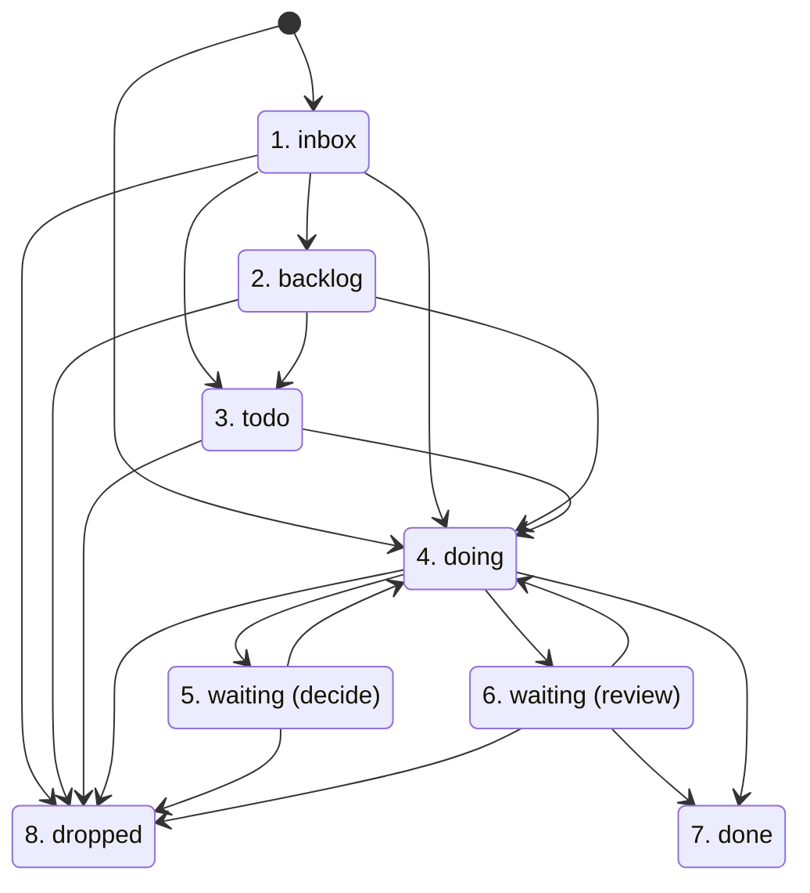

# Agent Office Protocol

| Version | Date | Author | Change |
|---|---|---|---|
| 0.1 | 2026-11-11 | GanniPiece | First version |
| 0.2 | 2026-11-11 | GanniPiece | Language profiles: headings, marker, breadcrumb words, and folders per language |

- Defines the vault file layout, ticket schema, state machine, and cadence for Agent Office, independent of any script or UI.
- Enables third-party tools to read and write the same Obsidian vault without data loss.
- Read [Roles](#roles), [Ticket format](#ticket-format), and [State machine](#state-machine) first.
- Not in this document:
  - Agent behavior rules inside a session: [locale/en/AGENTS.md](locale/en/AGENTS.md) (`zh-TW`: [locale/zh-TW/AGENTS.md](locale/zh-TW/AGENTS.md))
  - macOS reference scripts and terminal UI guide: [README.md](README.md)

## Roles

| Role | Actor | Permissions | Note |
|---|---|---|---|
| Manager | Human user | • Owns every ticket. <br>• Sets `status` to `done`, `dropped`, or `backlog`. <br>• Sets `owner`, `meeting`, and `agent_dir`. <br>• Marks delegated subtasks with `(agent)`. <br>• Answers decisions and accepts or rejects work. | Only the manager closes a ticket. |
| Team member | AI agent | • Works in background sessions on open `(agent)` subtasks or `owner: agent` tickets. <br>• Writes output notes under `Office/outputs/<id>/` and agendas under `Office/meetings/`. <br>• Sets `status: waiting` with `agent_state: decide` or `agent_state: review`. <br>• Sets `status: doing` and clears `agent_state` and `waiting_on` after the manager answers all open decisions. | Follows the behavior rules in [locale/en/AGENTS.md](locale/en/AGENTS.md). |

## Vault layout

| Path | Writer | Content | Note |
|---|---|---|---|
| `AGENTS.md` | Installer or Manager | Agent behavior rules for the vault. | `CLAUDE.md` and `GEMINI.md` contain `@AGENTS.md`. |
| `Tickets/T-<NNN> <title>.md` | Manager and Agent | One Markdown note per ticket. | The agent edits only the active ticket of the session. |
| `Tickets/Board.base` | Installer or Manager | Obsidian Bases configuration with `Needs me`, `Open`, and `Closed` views. | The agent must never edit this file. |
| `Daily/YYYY-MM-DD.md` | Manager and Agent | Daily note with `## Progress` and `## Next` sections. | Under `## Progress`, the agent keeps one numbered line per ticket: `[[T-<NNN> <title>]]: <one-line state>`. |
| `Office/meetings/<YYYY-MM-DD HHMM> <id>.md` | Manager and Agent | Meeting agenda and outcomes for one ticket meeting. | The file name omits the colon from `HH:MM`. |
| `Office/outputs/<id>/` | Agent | Work output notes for ticket `<id>`. | The agent links each output note in the ticket's `links` field. |
| `.agent-office/config` | Manager | `KEY=VALUE` settings for cadence and `AGENT_CLI`. | The agent must never edit `.agent-office/`. |
| `.agent-office/logs/` | Tooling | Lock directories, PID files, session logs, and timestamps. | Runtime state for schedulers and UIs. |
| `private/`, `.obsidian/`, `.trash/` | Manager and Obsidian | Private notes, editor configuration, and trash. | The agent must never read or write these paths. |

## Language profiles

A vault uses one language profile, set by `AO_LANG` in `.agent-office/config`. The profile sets the words in this document that are shown in the `en` form. The reference values are in `template/.agent-office/profiles/<lang>.conf`.

| Item | `en` | `zh-TW` |
|---|---|---|
| Done heading | `## Done when` | `## 完成條件` |
| Subtasks heading | `## Subtasks` | `## 子任務` |
| Decisions heading | `## Decisions` | `## Decisions` |
| Breadcrumbs heading | `## Breadcrumbs` | `## Breadcrumb` |
| Delegation marker | `(agent)` | `（agent）` |
| Breadcrumb words | `Stopped:`, `Next:` | `停在：`, `下一步：` |
| Meetings folder | `Office/meetings` | `Office/會議` |
| Outputs folder | `Office/outputs` | `Office/產出` |

- A tool writes the words of the vault's profile.
- A tool reads both delegation markers in every profile.
- A tool accepts the `en` headings in every profile, so a ticket written with English headings still works.

## Ticket format

Ticket files use the path `Tickets/T-<NNN> <title>.md`.

- `<NNN>` is a zero-padded integer of at least 3 digits (`T-001`, `T-002`).
- Next ticket number = highest existing `T-<NNN>` number in `Tickets/` + 1.
- Never reuse a ticket number.
- `<title>` must not contain `\ / : * ? " < > | # ^ [ ]`.

### Frontmatter fields

Every ticket starts with a YAML frontmatter block between `---` lines.

| Field | Value format | Setter | Note |
|---|---|---|---|
| `id` | `T-<NNN>` | Manager or Agent (on creation) | • Matches the file name prefix.<br>• Tools find a ticket by the file name prefix. When the two differ, the file name wins. |
| `status` | `inbox`, `backlog`, `todo`, `doing`, `waiting`, `done`, `dropped` | Manager or Agent (restricted) | • Only the manager sets `done`, `dropped`, or `backlog`. <br>• At most 3 tickets have `status: doing` at one time. |
| `project` | Short project string | Manager or Agent | Tools treat an empty value as `Other`. |
| `created` | `YYYY-MM-DD` | Manager or Agent (on creation) | Ticket creation date. |
| `updated` | `YYYY-MM-DD` | Manager or Agent | Set to the current date on every ticket edit. |
| `due` | `YYYY-MM-DD` or empty | Manager | Set only when the manager gives a date. |
| `waiting_on` | String or empty | Manager or Agent | • Non-empty only when `status` is `waiting`. <br>• For `decide`: `Manager: decide D<n> <one sentence>`. <br>• For `review`: `Manager: review <output>`. |
| `owner` | `agent` or empty | Manager | • `agent` delegates the whole ticket to the agent. <br>• Only the manager sets `owner`. |
| `meeting` | `YYYY-MM-DD HH:MM` or empty | Manager | • Next meeting time in local 24-hour time. <br>• The agent sets `meeting` only when the manager gives the time. |
| `agent_state` | `decide`, `review`, or empty | Agent or Manager | • Set by the agent when it waits for the manager. <br>• While `agent_state` is non-empty, the agent makes no progress on subtasks. |
| `links` | YAML list of wikilinks (`[]` when empty) | Manager or Agent | At most 5 wikilinks, such as `"[[Office/outputs/T-001/specs]]"`. |
| `agent_dir` | Absolute folder path or `~/...` | Manager | • **Optional.** <br>• External folder where the agent may read, write, and run code commands. <br>• Only the manager sets `agent_dir`. |

### Body sections

After the closing `---` of the frontmatter, the ticket body contains `# <title>` and these `##` sections in order:

| Section | Content | Note |
|---|---|---|
| `## Done when` | One or more sentences that state the acceptance condition. | Required before the agent can set `agent_state: review`. |
| `## Scope` | Extra path or action limits for this ticket. | • **Optional.** <br>• Can only make the vault rules in [locale/en/AGENTS.md](locale/en/AGENTS.md) stricter. |
| `## Subtasks` | Markdown task list (`- [ ] ...` and `- [x] ...`). | Controls subtask delegation. |
| `## Decisions` | Decision blocks (`### D<n> ...`). | Empty when no decision exists. |
| `## Breadcrumbs` | Reverse-chronological log of session stops and status updates. | Newest entry sits at the top. |

### Delegation marker

The manager delegates a ticket to the agent when at least one condition holds:

- Frontmatter `owner` equals `agent`.
- `## Subtasks` has an open task line that ends with ` (agent)` or `（agent）`, matching the regular expression `^[[:space:]]*- \[ \] .*(\(agent\)|（agent）)[[:space:]]*$`.

Subtasks without ` (agent)` belong to the manager unless `owner` equals `agent`. When the agent finishes a delegated subtask, it marks `- [x]` and keeps the trailing ` (agent)` text.

### Breadcrumb format

`## Breadcrumbs` holds one bullet line per entry, newest first.

| Author | Line format | Note |
|---|---|---|
| Agent | `- YYYY-MM-DD HH:MM · [agent] Stopped: <state>. Next: <one concrete action>.` | • Starts with `[agent]` after ` · `. <br>• When unsure, the agent writes `unsure` and the reason. |
| Manager or Tool | `- YYYY-MM-DD HH:MM · <entry>` | • Contains no `[agent]` tag. <br>• The agent reads the latest 3 manager breadcrumbs at session start and gives them priority over its earlier plan. |

### Decision block format

Under `## Decisions`, each open or answered decision uses this structure:

```markdown
### D1 The question in one sentence
- Option A: <description>. Cost: <cost>
- Option B: <description>. Cost: <cost>
- Recommendation: <option>, because <reason>
- Decision: (filled in at the meeting)
```

During a meeting, the agent writes the manager's answer on the `- Decision:` line.

## Agenda format

- File path: `Office/meetings/<YYYY-MM-DD HHMM> <id>.md`, where `<YYYY-MM-DD HHMM>` is the ticket's `meeting` value without the colon (for example, `Office/meetings/2026-11-11 1500 T-001.md`).
- Length: one screen at most.
- Frontmatter:
  ```yaml
  ---
  ticket: "[[<ticket file name>]]"
  meeting: YYYY-MM-DD HH:MM
  ---
  ```

The agenda body contains these 6 sections in order:

1. `Progress since the last meeting`
2. `Evidence` (wikilinks to notes under `Office/outputs/<id>/`)
3. `Decisions needed`
4. `Risks and blockers`
5. `Plan for the next stage`
6. `Outcomes` (filled in during the meeting)

## State machine



1. **inbox** (`status: inbox`, `agent_state` empty): New, unsorted ticket created by the manager or agent.
2. **backlog** (`status: backlog`, `agent_state` empty): Sorted ticket, not planned now. Only the manager sets `backlog`.
3. **todo** (`status: todo`, `agent_state` empty): Planned ticket, not started. The manager sets `todo` and moves it to `doing` when work starts.
4. **doing** (`status: doing`, `agent_state` empty): Active ticket (at most 3 at one time). The manager starts it, or the agent returns it from `waiting` after the manager answers all open decisions.
5. **waiting (decide)** (`status: waiting`, `agent_state: decide`): The agent sets this state and `waiting_on: Manager: decide D<n> <one sentence>` when it needs a manager decision.
6. **waiting (review)** (`status: waiting`, `agent_state: review`): The agent sets this state and `waiting_on: Manager: review <output>` when all delegated subtasks are `[x]` and `## Done when` holds true.
7. **done** (`status: done`, `agent_state` empty): Completed ticket. Only the manager sets `done` (or tells the agent in a meeting to set `done` after accepting the work).
8. **dropped** (`status: dropped`, `agent_state` empty): Cancelled ticket. Only the manager sets `dropped`, and tools never delete a ticket file.

| Transition or field | Allowed actor | Rule |
|---|---|---|
| `status` to `done`, `dropped`, `backlog` | Manager only | The agent sets `done` during a meeting only when the manager accepts the work. |
| `owner`, `agent_dir`, `meeting` | Manager only | The agent sets `meeting` only when the manager gives the meeting time. |
| `status: doing` to `status: waiting` (`decide` or `review`) | Agent or Manager | The agent sets `agent_state` and `waiting_on` at the same time. |
| `status: waiting` to `status: doing` | Agent or Manager | Allowed when the manager answers all open decisions or adds subtasks, and clears `agent_state` and `waiting_on`. |
| Any status other than `waiting` | Manager or Agent | Must clear `waiting_on` and `agent_state`. |

## Cadence

Schedulers read settings from `.agent-office/config`. An environment variable with the same name overrides the file value.

| Key | Default | Meaning |
|---|---|---|
| `AGENT_CLI` | `claude` | Agent CLI binary (`claude`, `codex`, `agy`, or `gemini`). |
| `WORK_EVERY_HOURS` | `4` | Minimum hours between background work sessions on the same ticket. |
| `WORK_HOURS_FROM` | `9` | Local start hour (0-23, inclusive) for scheduled work sessions. |
| `WORK_HOURS_TO` | `20` | Local end hour (0-23, exclusive) for scheduled work sessions. |
| `PREP_BEFORE_MIN` | `60` | Minutes before `meeting` to write the agenda. |
| `REMIND_BEFORE_MIN` | `5` | Minutes before `meeting` to send a reminder notification. |
| `AGENT_DIR_ROOTS` | Empty | • **Optional.**<br>• Folders where `agent_dir` may point, separated by `:`.<br>• Empty turns `agent_dir` off. |

On each scheduler tick (every 5 minutes in the reference `launchd` job), the scheduler checks each open ticket (`Tickets/T-*.md`, not `done` or `dropped`) in this order. Steps 1 and 2 apply to every open ticket. Step 3 applies only to delegated tickets. The scheduler starts sessions in the background and does not wait for them.

1. **Reminder**: Check whether `meeting` is in the future and within `REMIND_BEFORE_MIN` minutes. If `.agent-office/logs/<id>.reminded-<YYYY-MM-DD HHMM>` does not exist, create it and send one notification.
2. **Meeting prep**: Check whether `meeting` is in the future and within `PREP_BEFORE_MIN` minutes. If `Office/meetings/<YYYY-MM-DD HHMM> <id>.md` does not exist, no session runs on the ticket, and `.agent-office/logs/<id>.prepped-<YYYY-MM-DD HHMM>` does not exist: start a background `prep` session and skip step 3. The prep session creates the marker after it gets the lock. The marker allows one try per meeting, also when the session fails.
3. **Work session**: Run a background `work` session when all conditions hold:
   - `status` equals `doing`.
   - `agent_state` is empty.
   - Current local hour `H` satisfies `WORK_HOURS_FROM <= H < WORK_HOURS_TO`.
   - `now - last_work >= WORK_EVERY_HOURS * 3600`, where `last_work` comes from `.agent-office/logs/<id>.last-work` (`0` when missing).
   - No background session and no meeting runs on the ticket.

### Runtime files

Tools coordinate background and interactive sessions through `.agent-office/logs/`:

| Path | Format | Purpose |
|---|---|---|
| `<id>.lock/` | Directory with a `pid` file | • Per-ticket lock created with atomic `mkdir`.<br>• A background session skips when the lock exists and its `pid` is alive.<br>• A lock with a dead `pid` is stale, so the next session removes it.<br>• The session deletes the lock on exit. |
| `<id>.pid` | Integer PID | • Present while a background session runs on `<id>`. A session runs when this PID is alive.<br>• Interactive sessions tell the agent not to edit the ticket body until the session ends.<br>• Tools do not change ticket fields while a session runs. |
| `<id>.kind` | `work` or `prep` | Session type paired with `<id>.pid`. |
| `<id>.meeting.pid` | Integer PID | • Written by an interactive meeting or talk.<br>• While this PID is alive, no background session starts on `<id>`, and tools do not change ticket fields. |
| `<id>.last-work` | Epoch seconds | Written when a `work` session ends. |
| `<id>-last-work.txt`, `<id>-last-prep.txt` | Plain text | Combined standard output and standard error from the latest `work` or `prep` session. |
| `<id>.reminded-<YYYY-MM-DD HHMM>` | Empty file | Marks that the scheduler sent the reminder for that meeting time. |
| `<id>.prepped-<YYYY-MM-DD HHMM>` | Empty file | Written by the prep session after it gets the lock. Marks that agenda prep ran for that meeting time. |

## Conformance

An implementation conforms to the Agent Office v0.1 protocol when it satisfies all items below:

1. Preserves the vault paths in [Vault layout](#vault-layout) and never reads or writes `private/`, `.obsidian/`, or `.trash/`.
2. Reads and writes ticket frontmatter and body sections as defined in [Ticket format](#ticket-format), sets `updated` to `YYYY-MM-DD` on every write, and never deletes a ticket file.
3. Detects delegation from `owner: agent` or an open `- [ ] ... (agent)` or `- [ ] ...（agent）` subtask line under the subtasks heading.
8. Reads and writes the headings, marker, breadcrumb words, and folders of the vault's [language profile](#language-profiles).
4. Enforces the actor permissions in [State machine](#state-machine) for `done`, `dropped`, `backlog`, `owner`, `meeting`, and `agent_dir`. Clears `agent_state` and `waiting_on` whenever `status` is not `waiting`.
5. Checks that `agent_dir` is an existing absolute directory (after expanding a leading `~/`) inside one of the `AGENT_DIR_ROOTS` folders before passing it to an agent CLI. The agent can edit tickets, so the allowlist must live in a file that the agent cannot edit.
6. Runs scheduled reminders, meeting prep, and background work sessions according to [Cadence](#cadence) and coordinates concurrent sessions with `<id>.lock/` and `<id>.pid`.
7. Instructs every agent session to follow [locale/en/AGENTS.md](locale/en/AGENTS.md) and passes the current `YYYY-MM-DD HH:MM` timestamp for breadcrumbs.
