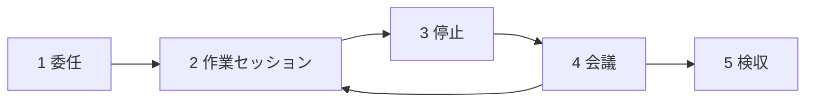

# Tarokaja

| Version | Date | Author | Change |
|---|---|---|---|
| 0.1 | 2026-11-11 | GanniPiece | Pre-release |

English: [README.md](README.md)

- Tarokaja は macOS 上の Obsidian vault 内で、AI agent をメンバーとして動かします。Vault がオフィスになり、マネージャーのために agent が働きます。
- 名前の由来：太郎冠者（Tarōkaja）は狂言の召使いです。主人に用事を言いつけられて出かけ、戻って報告し、次に何をするか尋ねます。
- チケットは通常の Markdown ノートです。コードだけでなくノート作成や調査も扱えます。チケットを完了にするのはマネージャーだけです。
- Agent は見張る対象ではなく、メンバーとして動きます。マネージャーの決定や検収が必要なところで止まります。[Tarokaja を選ぶ理由](#tarokaja-を選ぶ理由)を参照してください。
- [インストール](#インストール)と[初回実行](#初回実行)から始めて、vault を準備し、チケット `T-001` を完了してください。
- 本ドキュメントに含まれない内容：
  - ツール開発者向けのデータ形式と状態遷移の仕様：[PROTOCOL.md](PROTOCOL.md)
  - Vault 内の agent セッションのルール：[locale/en/AGENTS.md](locale/en/AGENTS.md)（`zh-TW`：[locale/zh-TW/AGENTS.md](locale/zh-TW/AGENTS.md)、`ja`：[locale/ja/AGENTS.md](locale/ja/AGENTS.md)）


- デモはサンプルのチケット（[docs/demo/make-vault.sh](docs/demo/make-vault.sh)）と、agent CLI の代役を使っています。
- 録画し直すには、repo のルートで `vhs docs/demo/demo.tape` を実行します。[VHS](https://github.com/charmbracelet/vhs) が必要です。

## Tarokaja を選ぶ理由

ほかのツールはこの流れの一部だけを扱います。Tarokaja はマネージャーとメンバーを中心に、全体を 1 つにまとめます。

| Feature | Tarokaja | Other tools | Note |
|---|---|---|---|
| マネージャー中心の流れ | • Agent は `agent_state: decide` または `review` で止まり、マネージャーを待ちます。<br>• マネージャーは会議で決定に答え、成果物を検収します。<br>• チケットを閉じるのはマネージャーだけです。 | 多くの agent ボードは、diff や pull request を出して終わります。 | |
| 1 枚のチケットでの分担 | • 末尾が `(agent)` のサブタスクは agent の担当です。<br>• ほかのサブタスクはマネージャーの担当です。 | 多くのボードはカード全体を 1 つの agent に割り当てます。 | |
| あらゆる種類の仕事 | チケットはコードだけでなく、ノート、調査、文書作成、事務作業も扱います。 | • Vibe Kanban はコード repo の git worktree で各タスクを実行します。<br>• Backlog.md はコード repo 内の Markdown ファイルとしてタスクを管理します。 | コードが必要なチケットには `agent_dir` でフォルダを指定します。 |
| ノートがそのままボード | • チケットは Obsidian vault 内の通常の Markdown です。<br>• 経過、Daily note、リンクは普段使うノートの中に残ります。 | 多くのボードは専用アプリやコード repo にタスクを置きます。 | Tarokaja なしでもすべてのチケットを読み書きできます。 |
| 選べる agent CLI | • Claude Code<br>• Codex CLI<br>• Antigravity CLI<br>• Gemini CLI | | 1 つの vault につき 1 つの CLI です。 |
| チケットごとの時間記録 | `timelog` add-on が各チケットのマネージャーと agent の時間を集計します。 | ピクセルオフィスやノッチ表示のアプリは、チケットと紐づかずに今のセッション状態だけを表示します。 | **Optional** の add-on です。 |
| 小さな構成 | • Bash、Python 標準ライブラリ、cmux、Obsidian で動きます。<br>• サーバー、データベース、アカウントは不要です。 | | macOS 専用です。 |

## コンセプト

Obsidian vault はオフィスです。マネージャーが仕事を管理し、AI agent がメンバーとして働きます。マネージャーは Markdown のチケットでサブタスクを委任し、agent の作業を見張りません。Agent はスケジュールに沿ってバックグラウンドの作業セッションで働き、決定や検収が必要なときに止まります。マネージャーは会議を開いて決定し、成果物を検収します。すべてのチケットの責任者はマネージャーのままで、agent がチケットを閉じることはありません。



1. マネージャーが `doing` のチケットでサブタスクに `(agent)` を付けるか、`owner: agent` を設定します。
2. `tick.sh` または `work.sh` が未完了の `(agent)` サブタスクに対して agent をバックグラウンドで実行し、`Office/outputs/<ticket ID>/` に成果物を書きます。
3. Agent が `[agent]` の経過を書き、`status: waiting` と `agent_state: decide` または `agent_state: review` を設定します。
4. マネージャーが `meeting.sh` を実行し、`## Decisions` の未解決の決定に答え、成果物のノートを検収します。
5. マネージャーが成果物を検収して `status: done` にするか、サブタスクを追加してチケットを `status: doing` に戻します。

## 必要環境

| Item | Requirement | Note |
|---|---|---|
| OS | macOS | スクリプトは `launchd`、`osascript`、BSD ユーティリティを使います。 |
| Vault アプリ | [Obsidian](https://obsidian.md) 1.9 以降 | `Tickets/Board.base` は Bases コアプラグインを使います。 |
| ターミナル | [cmux](https://cmux.com) | • TUI の右側の split で会議や対話を開きます。<br>• 通知を表示します。<br>• `cmux` がない場合、セッションは同じターミナルで開き、通知は `osascript` で表示します。 |
| Agent CLI | • Claude Code (`claude`)<br>• Codex CLI (`codex`)<br>• Google Antigravity CLI (`agy`)<br>• Gemini CLI (`gemini`) | • いずれか 1 つの CLI を `PATH` にインストールします。<br>• 個人向けの Gemini CLI 無料枠は使えなくなったため、`agy` または有料の Gemini API key を使ってください。<br>• 実機の CLI で動作確認済み：`claude`、`agy`。<br>• 実機の CLI で未確認：`codex`、`gemini`。<br>• ヘッドレスモードの `agy` はシェルコマンドを実行できないため、`agent_dir` でのコード作業には `claude` または `codex` が必要です。 |
| Python | `python3`（3.8 以降） | `xcode-select --install` で Xcode Command Line Tools をインストールします。 |

## インストール

1. `install.sh` を実行し、新しいフォルダまたは既存の Obsidian vault にテンプレートをコピーします：
   ```bash
   ./install.sh /path/to/vault --agent claude --lang en --schedule
   ```
2. Obsidian で `/path/to/vault` を vault として開きます。
3. `cmux` で vault のフォルダを開きます：
   ```bash
   cmux /path/to/vault
   ```
4. Vault のフォルダから TUI を起動します：
   ```bash
   python3 .tarokaja/tui.py
   ```

| Option | Default | Note |
|---|---|---|
| `VAULT_DIR` | | • 対象フォルダの path です。<br>• フォルダ内の既存ファイルは上書きされません。 |
| `--agent <cli>` | `claude` | • **Optional。**<br>• `.tarokaja/config` の `AGENT_CLI` に `claude`、`codex`、`agy`、`gemini` のいずれかを設定します。 |
| `--lang <lang>` | `en` | • **Optional。**<br>• 言語プロファイル（`en`、`zh-TW`、`ja`、例：`install.sh --lang ja`）を設定します（[言語プロファイル](#言語プロファイル)を参照）。<br>• `--lang` なしで再インストールすると、`config` の言語設定を維持します。 |
| `--addons <list>` | Empty | • **Optional。**<br>• [アドオン](#アドオン)で説明する add-on 名（`timelog`、`session`）をカンマ区切りで `.tarokaja/config` の `ADDONS` に設定します。<br>• `--addons` なしで再インストールすると、`config` の `ADDONS` を維持します。<br>• 不明な add-on 名を指定すると終了コード `2` で終了します。 |
| `--rules <path>` | `AGENTS.md` | • **Optional。**<br>• `VAULT_DIR` からの相対 path で agent ルールファイルの場所を指定します（例：`"Tarokaja/AGENTS.md"`）。<br>• `.tarokaja/config` の `RULES_FILE` を設定します。<br>• Vault 直下に `AGENTS.md`、`CLAUDE.md`、`GEMINI.md` が置かれなくなるため、vault 内の通常の agent セッションがオフィスのルールを読み込みません。<br>• `--rules` なしで再インストールすると、`RULES_FILE` を維持します。 |
| `--link` | Off | • **Optional。**<br>• [開発](#開発)で説明するとおり、スクリプトをコピーせずこの repo への symlink にします。 |
| `--schedule` | Off | • **Optional。**<br>• 5 分ごとに `.tarokaja/tick.sh` を実行する `launchd` ジョブ `local.tarokaja.tick` を読み込みます。 |

## 初回実行

`install.sh` はサンプルのチケット `T-001`（`en` では `Tickets/T-001 Try Tarokaja.md`、`ja` では `Tickets/T-001 Tarokaja を試す.md`）を作成します。初期状態は `status: doing` で、`(agent)`（`ja` では `（agent）`）が付いたサブタスクが 1 つあります。以下の手順は `en` の名前で書いています。`ja` では `T-001 Tarokaja を試す` と `Office/成果物/` に読み替えてください。すでにチケットがある vault にはサンプルのチケットを作成しません。

1. TUI で `T-001 Try Tarokaja` を選びます。
2. TUI で `w` を押すか、`.tarokaja/work.sh T-001` を実行して、バックグラウンドの作業セッションを 1 回開始します。
3. `Tickets/T-001 Try Tarokaja.md` の新しい `[agent]` の経過と、`Office/outputs/T-001/` の成果物ノートを読みます。
4. TUI で `m` を押すか、`.tarokaja/meeting.sh T-001` を実行して、会議を開き成果物を検収します。

## 日常の使い方

| Task | Method | Note |
|---|---|---|
| チケットを作る | • TUI で `n` を押します。<br>• Obsidian で `Tickets/T-<NNN> <title>.md` を作成します。<br>• Vault のセッションで agent にチケット作成を頼みます。 | TUI から作った新しいチケットは `status: inbox` で始まります。 |
| チケットを始める | TUI で `s` のあとに `d` を押すか、frontmatter で `status: doing` を設定します。 | `doing` のチケットは同時に最大 3 枚までにします。 |
| サブタスクを委任する | `## Subtasks` の未完了サブタスクの行末に ` (agent)` を付けるか、TUI で `t` を押して agent に伝えます。 | 次の作業セッションでそのサブタスクを実行します。 |
| チケット全体を委任する | チケットの frontmatter で `owner: agent` を設定します。 | `owner` を設定するのはマネージャーだけです。 |
| フォルダでのコード作業を許可する | 1. `.tarokaja/config` の `AGENT_DIR_ROOTS` に親フォルダを追加します。<br>2. チケットの frontmatter に `agent_dir: /absolute/path/to/repo` を設定します。 | • **Optional。**<br>• `work.sh` は `AGENT_DIR_ROOTS` の外にある `agent_dir` を拒否します。<br>• Agent はチケットを編集できるため、許可リストは Claude Code が編集できない `config` に置きます。 |
| マネージャー待ちのチケットを探す | TUI または `Tickets/Board.base` で `Needs me` を選びます。 | `agent_state` が `decide` または `review` のチケットを一覧表示します。 |
| 会議を予定する | TUI で `M` を押すか、frontmatter に `meeting: YYYY-MM-DD HH:MM` を設定します。 | `tick.sh` が会議の前にアジェンダを書き、リマインダーを送ります。 |
| 会議を開く | TUI で `m` を押すか、`.tarokaja/meeting.sh <ID>` を実行します。 | 未解決の決定に 1 つずつ答え、成果物を検収します。 |
| アジェンダなしで話す | TUI で `Enter` または `t` を押すか、`.tarokaja/meeting.sh <ID> --talk` を実行します。 | 進捗の確認、マネージャー自身の経過の記録、サブタスクの委任に使います。 |
| チケットを完了または中止にする | 会議で成果物を検収するか、TUI で `s` を押して `o`（`done`）または `x`（`dropped`）を選びます。 | `done` または `dropped` を設定するのはマネージャーだけです。 |

## TUI のキー

| Key | Action | Note |
|---|---|---|
| `j` / `Down`, `k` / `Up` | 選択中の列でカーソルを上下に動かします。 | |
| `h` / `Left`, `l` / `Right`, `Tab` | `Places` 列とチケット列の間でフォーカスを切り替えます。 | |
| `Enter` / `t` | 選択中のチケットについて agent と話します（`meeting.sh <ID> --talk`）。 | `cmux` 内では右側の split で開きます。 |
| `m` | 選択中のチケットの会議を開きます（`meeting.sh <ID>`）。 | `cmux` 内では右側の split で開きます。 |
| `M` | `meeting` の時刻（`YYYY-MM-DD HH:MM`）を設定または消去します。 | 空欄で入力すると `meeting` を消去します。 |
| `w` | バックグラウンドの作業セッションを今すぐ開始します（`work.sh <ID>`）。 | 未完了の `(agent)` サブタスクまたは `owner: agent` が必要です。 |
| `p` | バックグラウンドで会議のアジェンダを今すぐ作成します（`prep.sh <ID>`）。 | チケットに `meeting` の時刻が必要です。 |
| `s` | `status` を設定します：`i`（`inbox`）、`b`（`backlog`）、`t`（`todo`）、`d`（`doing`）、`w`（`waiting`）、`o`（`done`）、`x`（`dropped`）。 | `waiting` 以外の status にすると、`waiting_on` と `agent_state` を消去します。 |
| `n` | `Tickets/` に `status: inbox` で新しいチケットを作ります。 | 選択中のプロジェクト、または `Needs me` と `All open` からは `Other` を使います。 |
| `o` | 選択中のチケットを Obsidian で開きます。 | `obsidian://open` URL スキームを使います。 |
| `r` | ディスクからすべてのチケットを再読み込みします。 | ファイルが変更されると 3 秒ごとに自動で読み込みます。 |
| `R` | 今週のチケットごとの時間を表示します（`timelog.py week`）。 | `ADDONS` に `timelog` が必要です。 |
| `?` | ヘルプ画面の表示を切り替えます。 | |
| `q` / `Q` | TUI を終了します。 | |

## スクリプト

| Script | Command | Action | Note |
|---|---|---|---|
| `work.sh` | `.tarokaja/work.sh <ID>` | チケット `<ID>` でバックグラウンドの作業セッションを 1 回実行します。 | • `status: doing`、空の `agent_state`、未完了の `(agent)` サブタスクまたは `owner: agent` が必要です。<br>• `<ID>` で別のセッションが実行中のときはスキップし、クラッシュで残ったロックは削除します。<br>• Agent の最終回答を `.tarokaja/logs/<ID>-last-work.txt` に書き、エポック秒を `<ID>.last-work` に書きます。<br>• `claude` の場合、リアルタイムのイベントログも `.tarokaja/logs/<ID>-stream.jsonl` に書きます。 |
| `prep.sh` | `.tarokaja/prep.sh <ID>` | バックグラウンドのセッションを 1 回実行し、`Office/meetings/<YYYY-MM-DD HHMM> <ID>.md` に会議のアジェンダを書きます。 | • チケットに `meeting` が必要です。<br>• `<ID>` で別のセッションが実行中のときはスキップします。 |
| `meeting.sh` | • `.tarokaja/meeting.sh <ID>`<br>• `.tarokaja/meeting.sh <ID> --talk` | 会議または対話のために対話型の agent セッションを実行します。 | • `<ID>` でバックグラウンドのセッションが実行中のときは、チケット本文を編集しないよう agent に伝えます。<br>• 会議の実行中は、`<ID>` でバックグラウンドのセッションを開始しません。 |
| `tick.sh` | `.tarokaja/tick.sh` | • `meeting` があるすべての未完了チケットに対して、会議のリマインダーを送り `prep.sh` を実行します。<br>• 委任されたチケットに対して `work.sh` を開始します。 | • `--schedule` 付きでインストールした場合、`launchd` が 5 分ごとにこのスクリプトを実行します。<br>• セッションはバックグラウンドで始まるため、長いセッションがリマインダーを遅らせることはありません。<br>• `prep.sh` は失敗したときも含め、1 回の会議につき 1 回だけ実行します。 |
| `tui.py` | • `python3 .tarokaja/tui.py`<br>• `python3 .tarokaja/tui.py --print` | 3 列の TUI を実行するか、`--print` で未完了ボードを 1 回出力して終了します。 | Python 3.8 以降の標準ライブラリだけを使います。 |

## 設定

スクリプトは `.tarokaja/config` を読み込みます。同じ名前の環境変数がある場合、ファイルの値より優先します。

| Key | Default | Note |
|---|---|---|
| `TK_LANG` | `en` | 言語プロファイル：`en`、`zh-TW`、または `ja`。 |
| `AGENT_CLI` | `claude` | すべてのセッションで使う agent CLI：`claude`、`codex`、`agy`、または `gemini`。 |
| `WORK_EVERY_HOURS` | `4` | 同じチケットで定期実行する `work.sh` セッションの最小間隔（時間）です。 |
| `WORK_HOURS_FROM` | `9` | `tick.sh` が `work.sh` セッションを定期実行する開始時刻（ローカル 24 時間表記、この時刻を含む）です。 |
| `WORK_HOURS_TO` | `20` | `tick.sh` が `work.sh` セッションを定期実行する終了時刻（ローカル 24 時間表記、この時刻を含まない）です。 |
| `PREP_BEFORE_MIN` | `60` | アジェンダファイルがまだないときに、`tick.sh` が `prep.sh` を実行する `meeting` 前の分数です。 |
| `REMIND_BEFORE_MIN` | `5` | `tick.sh` が 1 回だけリマインダー通知を送る `meeting` 前の分数です。 |
| `AGENT_DIR_ROOTS` | Empty | • **Optional。**<br>• `agent_dir` に指定できるフォルダを `:` 区切りで並べます（例：`~/code:~/projects`）。<br>• 空欄にすると `agent_dir` を無効にします。 |
| `ADDONS` | Empty | • **Optional。**<br>• `.tarokaja/addons/` 内の add-on フォルダ名をカンマ区切りで並べます（例：`timelog,session`）。<br>• 空欄にするとすべての add-on を無効にし、コアの動作は何も変わりません。 |

## アドオン

インストール時または `.tarokaja/config` で add-on を有効にします：

```bash
./install.sh /path/to/vault --addons timelog,session
```

| Add-on | Behavior | Note |
|---|---|---|
| `timelog` | • 時間イベントを `{at, kind, ref}` として `.tarokaja/logs/time/<ID>.jsonl` に記録します。<br>• `<ID>` でセッションも会議も動いていないときに、チケットの frontmatter に `time_me` と `time_agent`（分）を書きます。<br>• 直近 7 日間の `Daily/YYYY-MM-DD.md` の `H_TIME`（`en` は `## Time`、`zh-TW` と `ja` は `## 時間`）の下にチケットごとの表を書きます。<br>• ノートのそのセクションだけを置き換え、存在しないノートは新規作成しません。<br>• チケットの status 変更を `.tarokaja/logs/status/<ID>.jsonl` に記録します。<br>• `python3 .tarokaja/addons/timelog/timelog.py week` または TUI の `R` で今週の時間を表示します。 | 各セッションや会議の終了時と、`tick.sh` の実行時に同期します。 |
| `session` | • 各チケットに 1 つの対話型 Claude Code セッションを紐づけます。<br>• チケットの frontmatter に `session: <SID>` を書き、`cmux` の surface と workspace を `.tarokaja/logs/sessions/<SID>.json` に書きます。<br>• トランスクリプトが存在する場合、次の `meeting.sh` で `claude --resume <SID>` によりそのセッションを再開します。<br>• `timelog` が有効な場合、対話型セッションの agent 時間も記録します。 | • `claude` 専用です。<br>• `addons/session/install.py <VAULT_DIR>` は `~/.claude` ではなく `<VAULT_DIR>/.claude/settings.json` に `SessionStart`、`UserPromptSubmit`、`PostToolUse`、`Stop` の hook を追加し、元ファイルをバックアップします。<br>• `install.py <VAULT_DIR> --remove` は追加した hook だけを削除します。 |

- `ADDONS` に含まれる各名前に対して、コアスクリプトは `.tarokaja/addons/<name>/on_event <EVENT> <ID> <REF>` を呼び出します。
- セッションのイベントは `session_start`、`session_tick`（60 秒ごと）、`session_end` です。`work` と `prep` のセッションでは `REF` に `bg` を設定します。
- バックグラウンドのセッションは `TK_HEADLESS=1` を export します。
- 会議のイベントは `meeting_start`、`meeting_tick`（60 秒ごと）、`meeting_end` です。`REF` には `meeting.sh` の PID を設定します。
- `ADDONS` が空でない場合、終了時に `meeting_end` を送れるよう、`meeting.sh` は agent を `exec` しません。
- `tick.sh` は 1 回の実行につき 1 回、`ID` と `REF` を `-` にして `tick` を送ります。
- Add-on が失敗してもコアスクリプトは止まりません（イベント仕様は [PROTOCOL.md](PROTOCOL.md) を参照してください）。

## 言語プロファイル

プロファイルは、スクリプト、TUI、agent がチケットで使う見出しや語句を定めます。`install.sh --lang ja` または `.tarokaja/config` の `TK_LANG` で選びます。設定ファイルは `.tarokaja/profiles/<lang>.conf` です。

| Key | `en` | `zh-TW` | `ja` | Note |
|---|---|---|---|---|
| `H_DONE` | `## Done when` | `## 完成條件` | `## 完了条件` | |
| `H_SUBTASKS` | `## Subtasks` | `## 子任務` | `## サブタスク` | |
| `H_DECISIONS` | `## Decisions` | `## Decisions` | `## Decisions` | |
| `H_CRUMBS` | `## Breadcrumbs` | `## Breadcrumb` | `## 経過` | |
| `H_TIME` | `## Time` | `## 時間` | `## 時間` | `timelog` add-on が Daily note に書く時間表の見出しです。 |
| `MARK` | `(agent)` | `（agent）` | `（agent）` | どのプロファイルでも、両方のマーカーを委任済みとして扱います。 |
| `CRUMB_STOP`, `CRUMB_NEXT` | `Stopped:`, `Next:` | `停在：`, `下一步：` | `現状：`, `次：` | |
| `MEETINGS_DIR` | `Office/meetings` | `Office/會議` | `Office/会議` | |
| `OUTPUTS_DIR` | `Office/outputs` | `Office/產出` | `Office/成果物` | |
| `RULES_FILE` | `AGENTS.md` | `AGENTS.md` | `AGENTS.md` | `install.sh` がプロファイルの言語のルールをコピーします。 |
| `WRITE_LANG` | `English` | `Traditional Chinese (Taiwan)…` | `Japanese, with English technical terms` | チケット本文と最終報告の言語です。 |

- 各 key は `.tarokaja/config` でも個別に設定できます。優先順位は、環境変数、`config`、プロファイル、組み込みの初期値の順です。
- 例：会議ノートを別のフォルダに置く vault では、`config` に `MEETINGS_DIR=Tarokaja/會議` を設定します。

## スケジュール

`install.sh --schedule` は `$HOME/Library/LaunchAgents/local.tarokaja.tick.<N>.plist` を書き出し、`launchd` ジョブ `local.tarokaja.tick.<N>` を読み込みます。`<N>` は vault path の checksum であるため、vault ごとに独立したジョブになります。`install.sh` は plist の path を出力します。この plist は `AbandonProcessGroup` を設定するため、`tick.sh` が終了しても `launchd` はバックグラウンドのセッションを止めません。ジョブは 300 秒ごとに `.tarokaja/tick.sh` を実行し、標準出力と標準エラーを `.tarokaja/logs/tick.out` と `.tarokaja/logs/tick.err` に書き出します。

1. ジョブのラベルを確認します：
   ```bash
   launchctl list | grep tarokaja
   ```
2. ジョブを止めます。`<N>` は手順 1 の番号に置き換えてください：
   ```bash
   launchctl bootout "gui/$(id -u)/local.tarokaja.tick.<N>"
   ```
3. plist ファイルを削除します：
   ```bash
   rm "$HOME/Library/LaunchAgents/local.tarokaja.tick.<N>.plist"
   ```

## 安全性

| Agent CLI | Access | Limit | Note |
|---|---|---|---|
| `claude` | • `--permission-mode acceptEdits` でファイルを編集します。<br>• `--allowedTools "Read,Edit,Write,Glob,Grep,WebSearch,WebFetch"` を使います。<br>• ヘッドレスモードで `agent_dir` がある場合、`--add-dir <agent_dir>` を追加し、`Bash(git:*)`、`Bash(uv:*)`、`Bash(python3:*)`、`Bash(ls:*)` を許可します。 | • `--disallowedTools` で `private/`、`.obsidian/`、`.trash/` の読み書きと、`.tarokaja/` の編集を禁止します。<br>• ヘッドレスのセッションを `--max-turns 40` で制限します。 | • `agent_dir` がある場合、これらのコマンドは `private/` や `.tarokaja/config` を含め、マネージャー権限で読み書きと実行ができます。<br>• 信頼できるチケットにだけ `agent_dir` を設定してください。 |
| `codex` | • `-C "$VAULT"` と `--skip-git-repo-check` で vault 内で実行します。<br>• ヘッドレスモードで `agent_dir` がある場合、`--add-dir <agent_dir>` を追加します。 | • `--sandbox workspace-write` の sandbox で書き込みを制限します。<br>• Path のルールは [locale/en/AGENTS.md](locale/en/AGENTS.md) に依拠します。 | この sandbox では、`codex` は `.tarokaja/config` を含む vault 内のすべてのファイルに書き込めます。 |
| `agy` | • `--mode accept-edits` でファイルを編集します。<br>• ヘッドレスモードで `agent_dir` がある場合、`--add-dir <agent_dir>` を追加します。 | • ヘッドレスのセッションを `--print-timeout 1800s` で停止します。<br>• Path のルールは [locale/en/AGENTS.md](locale/en/AGENTS.md) に依拠します。 | ヘッドレスモードではシェルコマンドを実行できません。 |
| `gemini` | • `--approval-mode auto_edit` と `--skip-trust` でファイルを編集します。<br>• ヘッドレスモードで `agent_dir` がある場合、`--include-directories <agent_dir>` を追加します。 | Path のルールは [locale/en/AGENTS.md](locale/en/AGENTS.md) に依拠します。 | 実機の `gemini` CLI では未確認です。 |

## 開発

1. この repo を clone し、`dev` など使いたいブランチをチェックアウトします。
2. リンク付きでインストールし、vault がチェックアウトしたコードを実行するようにします：
   ```bash
   ./install.sh /path/to/vault --lang zh-TW --link
   ```
3. Repo 内のコードを編集します。変更はすぐに vault に反映されます。

| Item | Behavior | Note |
|---|---|---|
| リンクされるファイル | `lib.sh`, `work.sh`, `prep.sh`, `meeting.sh`, `tick.sh`, `tui.py`, `profiles/`, `addons/` | それぞれ repo の `template/.tarokaja/` への symlink です。 |
| ローカルのファイル | `config`, `logs/` | Repo には入りません。 |
| 変更されたスクリプト | Repo と内容が異なる vault 内のスクリプトは `<name>.bak` として残ります。 | Repo と同じ内容のスクリプトはバックアップなしで置き換わります。 |

## テスト

Repo のルートからテストスイートを実行します：

```bash
bash tests/run.sh
```

`tests/run.sh` は一時フォルダ内で、スタブの `claude`、`codex`、`cmux`、`osascript` コマンドを使って実行します。実際の agent は呼び出しません。疑似ターミナル上で `en` と `zh-TW` の TUI 描画もテストします。

## トラブルシューティング

| Symptom | Cause | Fix |
|---|---|---|
| `T-001-last-work.txt` に `gemini` の `IneligibleTierError` が出る | 個人向けの Gemini CLI 無料枠が使えなくなりました。 | `AGENT_CLI=agy` を設定するか、有料の Gemini API key を使います。 |
| `claude` で数日後に定期実行セッションが止まる | Claude Code のログイン期限が切れ、バックグラウンドのジョブが再ログインできなくなりました。 | `claude setup-token` を実行し、自動実行ジョブにはそのトークンを使います。 |
| `tick.err` に `Operation not permitted` が出る | macOS のプライバシー制限が、`~/Documents` や iCloud Drive などのフォルダへの `launchd` ジョブのアクセスをブロックしています（未確認）。 | • Vault を `~/vaults` などのフォルダに移します。<br>• またはシステム設定で `/bin/bash` にフルディスクアクセスを許可します。 |
| TUI に長い間「a session running」と表示される | セッションが実行中か、agent CLI が入力待ちで止まっています。 | `.tarokaja/logs/<ID>-last-work.txt` と `.tarokaja/logs/agent.log` を確認します。 |

## 制限事項

- Web GUI はありません。
- 1 つの vault につき agent CLI は 1 つです（`.tarokaja/config` の `AGENT_CLI`）。
- チケットごとのセッション紐づけ（`session` add-on）は `claude` 専用です。
- macOS 専用です。

## ライセンス

MIT です。[LICENSE](LICENSE) を参照してください。
