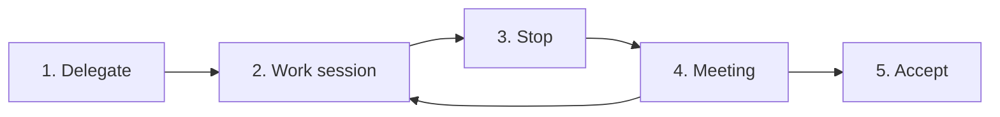

# Agent Office

| Version | Date | Author | Change |
|---|---|---|---|
| 0.1 | 2026-11-11 | GanniPiece | First version |
| 0.2 | 2026-11-11 | GanniPiece | Language profiles (`en`, `zh-TW`), `install.sh --lang` and `--link`, stream-json log for Claude Code |
| 0.3 | 2026-11-11 | GanniPiece | Add-ons: timelog and session |
| 0.4 | 2026-11-11 | GanniPiece | Why Agent Office: comparison with other agent tools |

- Agent Office runs an AI agent as a team member inside an Obsidian vault on macOS.
- Tickets are plain Markdown notes, work covers notes and research in addition to code, and only the manager closes a ticket.
- The agent works like a team member, not a tool that you watch: it stops for your decisions and your review. See [Why Agent Office](#why-agent-office).
- Start at [Installation](#installation) and [First run](#first-run) to set up a vault and complete ticket `T-001`.
- Not in this document:
  - Data format and state machine specification for tool authors: [PROTOCOL.md](PROTOCOL.md)
  - Agent session rules inside a vault: [locale/en/AGENTS.md](locale/en/AGENTS.md) (`zh-TW`: [locale/zh-TW/AGENTS.md](locale/zh-TW/AGENTS.md))

## Why Agent Office

Other tools cover one part of this workflow. Agent Office puts the parts together around a manager and a team member.

| Feature | Agent Office | Other tools | Note |
|---|---|---|---|
| Manager workflow | • The agent stops with `agent_state: decide` or `review` and waits for you.<br>• You answer in a meeting and accept the work.<br>• Only you close a ticket. | Most agent boards end with a diff or a pull request for you to review. | |
| Shared ownership in one ticket | • Subtasks that end with `(agent)` belong to the agent.<br>• All other subtasks stay yours. | Most boards assign a whole card to one agent. | |
| All kinds of work | Tickets cover notes, research, documents, and admin work, not only code. | • Vibe Kanban runs each task in a git worktree of a code repo.<br>• Backlog.md keeps tasks as Markdown files in a code repo. | `agent_dir` gives a ticket a code folder when it needs one. |
| Your notes are the board | • Tickets are plain Markdown in your Obsidian vault.<br>• Breadcrumbs, Daily notes, and links stay in the notes that you already use. | Most boards keep tasks in their own app or in a code repo. | You can read and edit every ticket without Agent Office. |
| One agent CLI or another | Claude Code, Codex CLI, Antigravity CLI, or Gemini CLI | | One CLI per vault |
| Time per ticket | The `timelog` add-on counts your time and the agent's time on each ticket. | Pixel-office and notch status apps show what a session does now, with no ticket behind it. | **Optional** add-on |
| Small footprint | • Bash, Python standard library, cmux, and Obsidian<br>• No server, database, or account | | macOS only |

## Concept

The Obsidian vault is an office. You are the manager, and the AI agent is a team member. You delegate subtasks on Markdown ticket notes and do not watch the agent work. The agent works in background sessions on a schedule and stops when it needs a decision or a review. You hold meetings to make decisions and accept work. You stay the owner of every ticket, and the agent never closes a ticket.



1. The manager marks a subtask with `(agent)` or sets `owner: agent` on a `doing` ticket.
2. `tick.sh` or `work.sh` runs the agent in the background on open `(agent)` subtasks and writes outputs under `Office/outputs/<ticket ID>/`.
3. The agent writes an `[agent]` breadcrumb and sets `status: waiting` with `agent_state: decide` or `agent_state: review`.
4. The manager runs `meeting.sh` to answer open decisions under `## Decisions` and review the output notes.
5. The manager accepts the work and sets `status: done`, or adds subtasks and returns the ticket to `status: doing`.

## Requirements

| Item | Requirement | Note |
|---|---|---|
| Operating system | macOS | Scripts use `launchd`, `osascript`, and BSD utilities. |
| Vault app | [Obsidian](https://obsidian.md) 1.9 or later | `Tickets/Board.base` uses the Bases core plugin. |
| Terminal | [cmux](https://cmux.com) | • Opens meetings and talks in a split on the right of the TUI.<br>• Shows the notifications.<br>• Without `cmux`, sessions open in the same terminal, and notifications come from `osascript`. |
| Agent CLI | • Claude Code (`claude`). <br>• Codex CLI (`codex`). <br>• Google Antigravity CLI (`agy`). <br>• Gemini CLI (`gemini`). | • Install one CLI on `PATH`. <br>• Gemini CLI free tier for individuals no longer works, so use `agy` or a paid Gemini API key. <br>• Tested with a real CLI: `claude`, `agy`.<br>• Not verified with a real CLI: `codex`, `gemini`.<br>• `agy` in headless mode cannot run shell commands, so `agent_dir` code work needs `claude` or `codex`. |
| Python | `python3` (3.8 or later) | Install Xcode Command Line Tools with `xcode-select --install`. |

## Installation

1. Run `install.sh` to copy the vault template into a new folder or an existing Obsidian vault:
   ```bash
   ./install.sh /path/to/vault --agent claude --lang en --schedule
   ```
2. Open `/path/to/vault` as a vault in Obsidian.
3. Open the vault folder in `cmux`:
   ```bash
   cmux /path/to/vault
   ```
4. Start the TUI from the vault folder:
   ```bash
   python3 .agent-office/tui.py
   ```

| Option | Default | Note |
|---|---|---|
| `VAULT_DIR` | | • Target folder path. <br>• Existing files in the folder stay untouched. |
| `--agent <cli>` | `claude` | • **Optional.** <br>• Sets `AGENT_CLI` in `.agent-office/config` to `claude`, `codex`, `agy`, or `gemini`. |
| `--lang <lang>` | `en` | • **Optional.**<br>• Sets the language profile: `en` or `zh-TW`. See [Language profiles](#language-profiles).<br>• A reinstall without `--lang` keeps the language in `config`. |
| `--addons <list>` | Empty | • **Optional.** <br>• Sets `ADDONS` in `.agent-office/config` to comma-separated add-on names (`timelog`, `session`), described in [Add-ons](#add-ons). <br>• A reinstall without `--addons` keeps `ADDONS` in `config`. <br>• An unknown add-on name exits with status `2`. |
| `--rules <path>` | `AGENTS.md` | • **Optional.** <br>• Path of the agent rules file, relative to `VAULT_DIR`, such as `"Agent Office/AGENTS.md"`. <br>• Sets `RULES_FILE` in `.agent-office/config`. <br>• The vault root then gets no `AGENTS.md`, `CLAUDE.md`, or `GEMINI.md`, so your own agent sessions in the vault do not load the office rules. <br>• A reinstall without `--rules` keeps `RULES_FILE`. |
| `--link` | Off | • **Optional.**<br>• Links the scripts to this repo instead of copying them. See [Development](#development). |
| `--schedule` | Off | • **Optional.** <br>• Loads the `launchd` job `local.agent-office.tick` to run `.agent-office/tick.sh` every 5 minutes. |

## First run

`install.sh` creates the example ticket `T-001` (`Tickets/T-001 Try Agent Office.md` for `en`) with `status: doing` and one subtask marked `(agent)`. A vault that has tickets already does not get the example ticket.

1. Select `T-001 Try Agent Office` in the TUI.
2. Press `w` in the TUI, or run `.agent-office/work.sh T-001`, to start one background work session.
3. Read the new `[agent]` breadcrumb in `Tickets/T-001 Try Agent Office.md` and the output note under `Office/outputs/T-001/`.
4. Press `m` in the TUI, or run `.agent-office/meeting.sh T-001`, to hold the meeting and accept the work.

## Daily use

| Task | Method | Note |
|---|---|---|
| Create a ticket | • Press `n` in the TUI. <br>• Create `Tickets/T-<NNN> <title>.md` in Obsidian. <br>• Ask the agent in a vault session to open a ticket. | New tickets from the TUI start with `status: inbox`. |
| Start a ticket | Press `s` then `d` in the TUI, or set `status: doing` in frontmatter. | Keep at most 3 tickets in `doing` at one time. |
| Delegate a subtask | Add ` (agent)` to the end of an open subtask line under `## Subtasks`, or press `t` in the TUI and tell the agent. | The next work session works on the subtask. |
| Delegate a whole ticket | Set `owner: agent` in the ticket frontmatter. | Only the manager sets `owner`. |
| Allow code work in a folder | 1. Add the parent folder to `AGENT_DIR_ROOTS` in `.agent-office/config`.<br>2. Set `agent_dir: /absolute/path/to/repo` in the ticket frontmatter. | • **Optional.**<br>• `work.sh` refuses an `agent_dir` outside `AGENT_DIR_ROOTS`. The agent can edit tickets, so the allowlist stays in `config`, which Claude Code may not edit. |
| Find tickets waiting on you | Select `Needs me` in the TUI or in `Tickets/Board.base`. | Lists tickets where `agent_state` is `decide` or `review`. |
| Schedule a meeting | Press `M` in the TUI, or set `meeting: YYYY-MM-DD HH:MM` in frontmatter. | `tick.sh` writes the agenda before the meeting and sends a reminder. |
| Hold a meeting | Press `m` in the TUI, or run `.agent-office/meeting.sh <ID>`. | Answer open decisions one at a time and accept or reject the work. |
| Talk without an agenda | Press `Enter` or `t` in the TUI, or run `.agent-office/meeting.sh <ID> --talk`. | Ask for progress, record your own steps, or delegate a subtask. |
| Close or drop a ticket | Accept the work during a meeting, or press `s` in the TUI and select `o` (`done`) or `x` (`dropped`). | Only the manager sets `done` or `dropped`. |

## TUI keys

| Key | Action | Note |
|---|---|---|
| `j` / `Down`, `k` / `Up` | Move selection down or up in the active column. | |
| `h` / `Left`, `l` / `Right`, `Tab` | Switch focus between the `Places` column and the tickets column. | |
| `Enter` / `t` | Talk to the agent about the selected ticket (`meeting.sh <ID> --talk`). | Opens in a `cmux` right split when inside `cmux`. |
| `m` | Hold the meeting for the selected ticket (`meeting.sh <ID>`). | Opens in a `cmux` right split when inside `cmux`. |
| `M` | Set or clear the `meeting` time (`YYYY-MM-DD HH:MM`). | Empty input clears `meeting`. |
| `w` | Start a background work session now (`work.sh <ID>`). | Requires an open `(agent)` subtask or `owner: agent`. |
| `p` | Write the meeting agenda in the background now (`prep.sh <ID>`). | Requires a `meeting` time on the ticket. |
| `s` | Set `status`: `i` (`inbox`), `b` (`backlog`), `t` (`todo`), `d` (`doing`), `w` (`waiting`), `o` (`done`), `x` (`dropped`). | Any status other than `waiting` clears `waiting_on` and `agent_state`. |
| `n` | Create a new ticket in `Tickets/` with `status: inbox`. | Uses the selected project, or `Other` from `Needs me` and `All open`. |
| `o` | Open the selected ticket in Obsidian. | Uses the `obsidian://open` URL scheme. |
| `r` | Reload all tickets from disk. | Polls automatically every 3 seconds when files change. |
| `R` | Show this week's time per ticket (`timelog.py week`). | Requires `timelog` in `ADDONS`. |
| `?` | Toggle the help overlay. | |
| `q` / `Q` | Quit the TUI. | |

## Scripts

| Script | Command | Action | Note |
|---|---|---|---|
| `work.sh` | `.agent-office/work.sh <ID>` | Runs one background work session on ticket `<ID>`. | • Requires `status: doing`, empty `agent_state`, and an open `(agent)` subtask or `owner: agent`. <br>• Skips while another session on `<ID>` runs. A lock left by a crash is removed. <br>• Writes the final answer of the agent to `.agent-office/logs/<ID>-last-work.txt` and epoch seconds to `<ID>.last-work`.<br>• With `claude`, also writes the live event log to `.agent-office/logs/<ID>-stream.jsonl`. |
| `prep.sh` | `.agent-office/prep.sh <ID>` | Runs one background session to write the meeting agenda at `Office/meetings/<YYYY-MM-DD HHMM> <ID>.md`. | • Requires `meeting` on the ticket. <br>• Skips while another session on `<ID>` runs. |
| `meeting.sh` | • `.agent-office/meeting.sh <ID>`. <br>• `.agent-office/meeting.sh <ID> --talk`. | Runs an interactive agent session for a meeting or an ad-hoc talk. | • Tells the agent not to edit the ticket body while a background session runs on `<ID>`.<br>• While a meeting runs, no background session starts on `<ID>`. |
| `tick.sh` | `.agent-office/tick.sh` | • Sends meeting reminders and runs `prep.sh` for every open ticket with a `meeting`.<br>• Starts `work.sh` for delegated tickets. | • `launchd` runs this script every 5 minutes when installed with `--schedule`.<br>• Sessions start in the background, so a long session does not delay a reminder.<br>• `prep.sh` runs one time per meeting, also when it fails. |
| `tui.py` | • `python3 .agent-office/tui.py`. <br>• `python3 .agent-office/tui.py --print`. | Runs the 3-column terminal UI, or prints the open board once and exits with `--print`. | Uses the Python 3.8+ standard library only. |

## Configuration

The scripts read `.agent-office/config`. An environment variable with the same name overrides the file value.

| Key | Default | Note |
|---|---|---|
| `AO_LANG` | `en` | Language profile: `en` or `zh-TW`. |
| `AGENT_CLI` | `claude` | Agent CLI for all sessions: `claude`, `codex`, `agy`, or `gemini`. |
| `WORK_EVERY_HOURS` | `4` | Minimum hours between scheduled `work.sh` sessions on the same ticket. |
| `WORK_HOURS_FROM` | `9` | Start hour in local 24-hour time (inclusive) for scheduled `work.sh` sessions in `tick.sh`. |
| `WORK_HOURS_TO` | `20` | End hour in local 24-hour time (exclusive) for scheduled `work.sh` sessions in `tick.sh`. |
| `PREP_BEFORE_MIN` | `60` | Minutes before `meeting` when `tick.sh` runs `prep.sh` if the agenda file does not exist yet. |
| `REMIND_BEFORE_MIN` | `5` | Minutes before `meeting` when `tick.sh` sends a one-time reminder notification. |
| `AGENT_DIR_ROOTS` | Empty | • **Optional.**<br>• Folders where `agent_dir` may point, separated by `:`, such as `~/code:~/projects`.<br>• Empty turns `agent_dir` off. |
| `ADDONS` | Empty | • **Optional.** <br>• Comma-separated add-on folder names in `.agent-office/addons/`, such as `timelog,session`. <br>• Empty turns all add-ons off and changes nothing in the core. |

## Add-ons

Turn on add-ons during installation or in `.agent-office/config`:

```bash
./install.sh /path/to/vault --addons timelog,session
```

| Add-on | Behavior | Note |
|---|---|---|
| `timelog` | • Logs time events as `{at, kind, ref}` in `.agent-office/logs/time/<ID>.jsonl`. <br>• Writes `time_me` and `time_agent` (minutes) into ticket frontmatter when no session or meeting runs on `<ID>`. <br>• Writes a per-ticket table under `H_TIME` (`## Time` in `en`, `## 時間` in `zh-TW`) in `Daily/YYYY-MM-DD.md` for the last 7 days. <br>• Replaces only that section of the note. Never creates a missing note. <br>• Records ticket status changes in `.agent-office/logs/status/<ID>.jsonl`. <br>• `python3 .agent-office/addons/timelog/timelog.py week` prints this week's time. `R` in the TUI shows the same report. | Syncs at the end of each session or meeting and on each `tick.sh` run. |
| `session` | • Binds one interactive Claude Code session to each ticket. <br>• Writes `session: <SID>` in ticket frontmatter and `.agent-office/logs/sessions/<SID>.json` with the `cmux` surface and workspace. <br>• Resumes that session with `claude --resume <SID>` in the next `meeting.sh` when its transcript exists. <br>• With `timelog` on, also logs agent time for the interactive session. | • Works with `claude` only. <br>• `addons/session/install.py <VAULT_DIR>` adds `SessionStart`, `UserPromptSubmit`, `PostToolUse`, and `Stop` hooks to `<VAULT_DIR>/.claude/settings.json`, never to `~/.claude`, and backs up the file. <br>• `install.py <VAULT_DIR> --remove` removes only its hooks. |

- For each name in `ADDONS`, the core scripts call `.agent-office/addons/<name>/on_event <EVENT> <ID> <REF>`.
- Session events are `session_start`, `session_tick` (every 60 s), and `session_end` with `REF` set to `bg` for `work` and `prep` sessions.
- Background sessions export `AO_HEADLESS=1`.
- Meeting events are `meeting_start`, `meeting_tick` (every 60 s), and `meeting_end` with `REF` set to the `meeting.sh` PID.
- With `ADDONS` non-empty, `meeting.sh` does not `exec` the agent, so it can send `meeting_end` on exit.
- `tick.sh` sends `tick` with `ID` and `REF` set to `-` once per run.
- A failing add-on never stops the core scripts (see [PROTOCOL.md](PROTOCOL.md) for the event specification).

## Language profiles

A profile sets the words that the scripts, the TUI, and the agent use in tickets. `AO_LANG` in `.agent-office/config` selects it. The files are `.agent-office/profiles/<lang>.conf`.

| Key | `en` | `zh-TW` | Note |
|---|---|---|---|
| `H_DONE` | `## Done when` | `## 完成條件` | |
| `H_SUBTASKS` | `## Subtasks` | `## 子任務` | |
| `H_DECISIONS` | `## Decisions` | `## Decisions` | |
| `H_CRUMBS` | `## Breadcrumbs` | `## Breadcrumb` | |
| `H_TIME` | `## Time` | `## 時間` | Heading for the daily time table from the `timelog` add-on. |
| `MARK` | `(agent)` | `（agent）` | Both markers count as delegated in every profile. |
| `CRUMB_STOP`, `CRUMB_NEXT` | `Stopped:`, `Next:` | `停在：`, `下一步：` | |
| `MEETINGS_DIR` | `Office/meetings` | `Office/會議` | |
| `OUTPUTS_DIR` | `Office/outputs` | `Office/產出` | |
| `RULES_FILE` | `AGENTS.md` | `AGENTS.md` | `install.sh` copies the rules of the profile language. |
| `WRITE_LANG` | `English` | `Traditional Chinese (Taiwan)…` | The language of ticket text and of the final report |

- You can set each key in `.agent-office/config` too. Order: environment variable, `config`, profile, built-in default.
- Example: a vault that keeps its meeting notes in another folder sets `MEETINGS_DIR=Agent Office/會議` in `config`.

## Schedule

`install.sh --schedule` writes `$HOME/Library/LaunchAgents/local.agent-office.tick.<N>.plist` and loads the `launchd` job `local.agent-office.tick.<N>`. `<N>` is a checksum of the vault path, so each vault has its own job. `install.sh` prints the plist path. The plist sets `AbandonProcessGroup`, so `launchd` does not stop the background sessions when `tick.sh` exits. The job runs `.agent-office/tick.sh` every 300 seconds and writes standard output and error to `.agent-office/logs/tick.out` and `.agent-office/logs/tick.err`.

1. Find the job label:
   ```bash
   launchctl list | grep agent-office
   ```
2. Stop the job. Replace `<N>` with the number from step 1:
   ```bash
   launchctl bootout "gui/$(id -u)/local.agent-office.tick.<N>"
   ```
3. Remove the plist file:
   ```bash
   rm "$HOME/Library/LaunchAgents/local.agent-office.tick.<N>.plist"
   ```

## Safety

| Agent CLI | Access | Limit | Note |
|---|---|---|---|
| `claude` | • Edits files with `--permission-mode acceptEdits`. <br>• Uses `--allowedTools "Read,Edit,Write,Glob,Grep,WebSearch,WebFetch"`. <br>• With `agent_dir` in headless mode, adds `--add-dir <agent_dir>` and enables `Bash(git:*)`, `Bash(uv:*)`, `Bash(python3:*)`, and `Bash(ls:*)`. | • `--disallowedTools` blocks read and edit of `private/`, `.obsidian/`, and `.trash/`, and edit of `.agent-office/`. <br>• Caps headless sessions at `--max-turns 40`. | • With `agent_dir`, these commands can read, write, and run anything that you can, also `private/` and `.agent-office/config`.<br>• Set `agent_dir` only on tickets that you trust. |
| `codex` | • Runs in the vault with `-C "$VAULT"` and `--skip-git-repo-check`. <br>• With `agent_dir` in headless mode, adds `--add-dir <agent_dir>`. | • Restricts writes with the `--sandbox workspace-write` sandbox. <br>• Relies on [locale/en/AGENTS.md](locale/en/AGENTS.md) for path rules. | The sandbox lets `codex` write any file in the vault, also `.agent-office/config`. |
| `agy` | • Edits files with `--mode accept-edits`. <br>• With `agent_dir` in headless mode, adds `--add-dir <agent_dir>`. | • Stops headless sessions at `--print-timeout 1800s`. <br>• Relies on [locale/en/AGENTS.md](locale/en/AGENTS.md) for path rules. | Cannot run shell commands in headless mode. |
| `gemini` | • Edits files with `--approval-mode auto_edit` and `--skip-trust`. <br>• With `agent_dir` in headless mode, adds `--include-directories <agent_dir>`. | Relies on [locale/en/AGENTS.md](locale/en/AGENTS.md) for path rules. | Not verified with a real `gemini` CLI. |

## Development

1. Clone this repo and check out the branch that you want to use, such as `dev`.
2. Install with links, so the vault runs the code of your checkout:
   ```bash
   ./install.sh /path/to/vault --lang zh-TW --link
   ```
3. Edit the code in the repo. The vault uses the change at once.

| Item | Behavior | Note |
|---|---|---|
| Linked files | `lib.sh`, `work.sh`, `prep.sh`, `meeting.sh`, `tick.sh`, `tui.py`, `profiles/`, `addons/` | Each one is a symlink into `template/.agent-office/` of the repo. |
| Local files | `config`, `logs/` | Never in the repo |
| Changed scripts | A script in the vault that differs from the repo is kept as `<name>.bak`. | A script that is the same as the repo is replaced without a backup. |

## Tests

Run the test suite from the repository root:

```bash
bash tests/run.sh
```

`tests/run.sh` runs in temporary directories with stub `claude`, `codex`, `cmux`, and `osascript` commands. It never calls a real agent. It also draws the TUI in a pseudo-terminal in `en` and `zh-TW`.

## Troubleshooting

| Symptom | Cause | Fix |
|---|---|---|
| `T-001-last-work.txt` shows `IneligibleTierError` from `gemini` | The Gemini CLI free tier for individuals stopped working. | Set `AGENT_CLI=agy`, or use a paid Gemini API key. |
| Scheduled sessions stop after some days with `claude` | The Claude Code sign-in expired. A background job cannot sign in again. | Run `claude setup-token` and use that token for unattended jobs. |
| `tick.err` shows `Operation not permitted` | macOS privacy controls block `launchd` jobs from folders such as `~/Documents` or iCloud Drive. Not verified. | • Move the vault to a folder such as `~/vaults`.<br>• Or give `/bin/bash` Full Disk Access in System Settings. |
| The TUI says "a session running" for a long time | A session runs, or the agent CLI waits for input. | Read `.agent-office/logs/<ID>-last-work.txt` and `.agent-office/logs/agent.log`. |

## Limits

- No web GUI.
- One agent CLI per vault (`AGENT_CLI` in `.agent-office/config`).
- Session binding per ticket (`session` add-on) works with `claude` only.
- macOS only.

## License

MIT. See [LICENSE](LICENSE).
